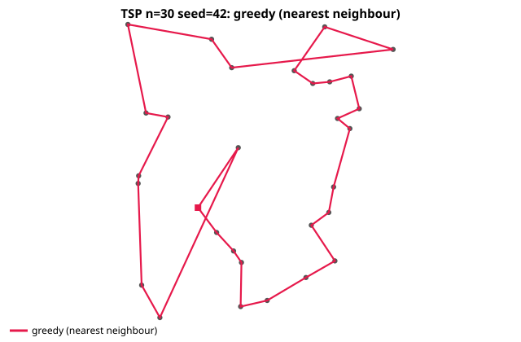
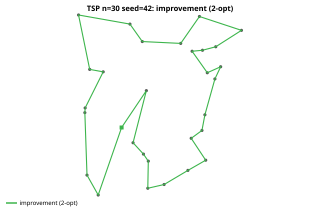
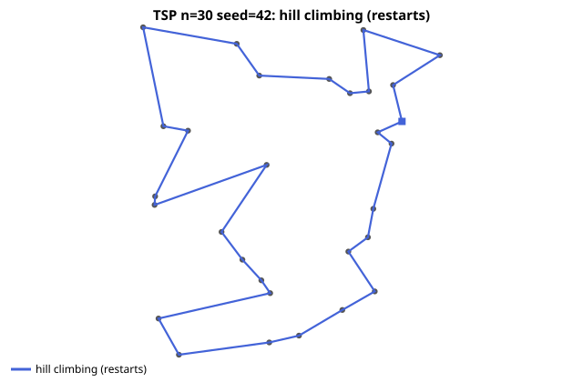
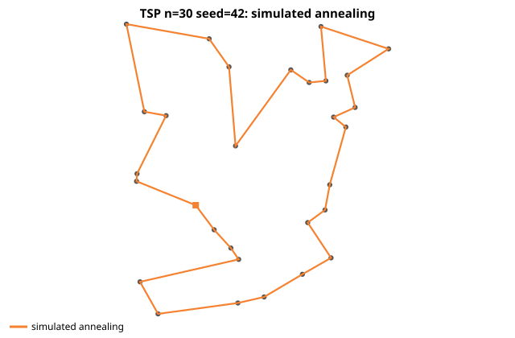
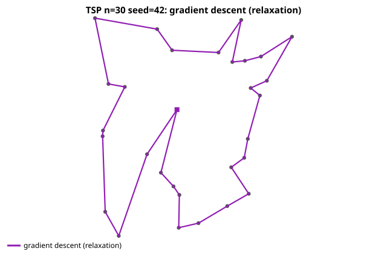
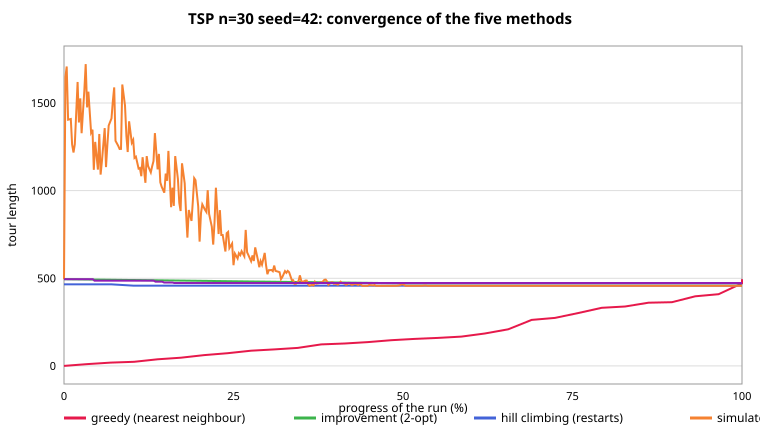

# HW8: Traveling Salesman Problem — Five Solving Methods

Solve the **Traveling Salesman Problem (TSP)** with five different algorithms:

| # | Method (as assigned) | File | Type |
|---|---|---|---|
| 1 | 改良法 — Improvement method | [`improvement.py`](improvement.py) | deterministic 2-opt local search |
| 2 | 爬山演算法 — Hill climbing | [`hill_climbing.py`](hill_climbing.py) | randomized greedy ascent + random restarts |
| 3 | 模擬退火法 — Simulated annealing | [`simulated_annealing.py`](simulated_annealing.py) | Metropolis search with geometric cooling |
| 4 | 梯度下降法 — Gradient descent | [`gradient_descent.py`](gradient_descent.py) | projected GD on a continuous relaxation |
| 5 | 貪婪演算法 — Greedy algorithm | [`greedy.py`](greedy.py) | nearest-neighbour construction, all starts |

Supporting files: [`tsp_core.py`](tsp_core.py) (instances, tour utilities, 2-opt/swap
operators, SVG plotting), [`main.py`](main.py) (CLI, demo, benchmark), [`test_tsp.py`](test_tsp.py)
(correctness suite). Everything is standard Python 3 + NumPy — no other dependencies.

---

## 1. Problem statement

Given `n` cities (points in the plane) with pairwise Euclidean distances
`D[i][j]`, find the **shortest closed tour** that visits every city exactly
once and returns to the start.

* A tour is a **permutation** of the cities: `order = (c0, c1, ..., c(n-1))`,
  its length is `sum D[order[i]][order[i+1]]` (indices mod `n`).
* There are `(n-1)! / 2` distinct tours (up to direction and start), so
  exhaustive search dies at roughly `n = 12`. TSP is **NP-hard** — every
  practical method below is a heuristic that trades optimality for speed.
* We use the standard **symmetric Euclidean** TSP on uniform random points in
  the `[0, 100]²` square (plus circle/cluster generators for sanity cases).

Two **local move operators** are shared by the search methods:

* **swap** — exchange the cities at two positions of the tour;
* **2-opt** — the only way to remove two edges and reconnect the tour into a
  single cycle: reverse the segment between them.

```
     tour:   ... a - b ------- c - d ...
     2-opt:  ... a - c ------- b - d ...      (segment b..c reversed)
```

`tsp_core.py` computes both deltas in **O(1)** (`swap_delta`, `opt2_delta`),
and the exhaustive optimum for `n <= 10` (`brute_force_tsp`) serves as the
reference in tests and small benchmarks.

---

## 2. Method 5 — Greedy algorithm (nearest neighbour)

*(Listed first here because the other methods use its output as their
starting point.)*

### Principle

Start at some city; repeatedly travel to the **nearest unvisited** city; when
all are visited, return to the start. A tour is built greedily in one pass —
each step is locally optimal, but the *first* step fixes everything, so we run
the heuristic from **every possible start city** and keep the best of the `n`
tours (for large `n`, a random sample of starts).

### Worked example (5 cities, `make_cities(5, seed=3)`)

| city | 0 | 1 | 2 | 3 | 4 |
|---|---|---|---|---|---|
| position | (8.6, 23.7) | (80.1, 58.2) | (9.4, 43.3) | (47.9, 16.0) | (73.5, 11.4) |

Nearest-neighbour from city 0:

```
0 -> 2 (19.6) -> 3 (47.2) -> 4 (26.0) -> 1 (47.3) -> back to 0 (79.5)
length = 219.6
```

The last edge back to the start is the longest of the tour — the classic
greedy failure mode: it is blind to the closing edge until the very end.

### Complexity

`O(n²)` per run (nearest-unvisited lookup from the distance matrix), `O(n³)`
for all-start greedy. It is by far the fastest method and a fine *seed* for
the improvers, but it has no optimality guarantee: on larger instances it is
typically **10–16% above** the best tour (see §7).

---

## 3. Method 1 — Improvement method (deterministic 2-opt)

### Principle

"First build a feasible tour, then improve it." Start from a good tour (the
greedy one), and repeatedly look for any pair of edges whose removal can be
reconnected **shorter** — a 2-opt move. Scan all pairs `(i, j)` in a fixed
order, apply the **first** improving reversal, restart the scan, and stop when
a full scan finds none: the tour is then **2-optimal** (no single 2-opt move
shortens it). Deterministic: same input → same output.

### Worked example (same 5 cities)

```
tour  [0, 1, 3, 2, 4]            length 317.4
      edges: 0-1 (79.5)  3-2 (47.2)   ... plus 1-3, 2-4, 4-0
2-opt (i=0, j=3): remove edges 0-1 and 2-4, add 0-2 and 1-4
      delta = D[0,2] + D[1,4] - D[0,1] - D[2,4]
            = 19.6 + 47.3 - 79.5 - 71.6 = -84.2      (improving!)
tour  [0, 2, 3, 1, 4]            length 233.4   ✓ shorter by 84.2
```

The move is exactly the ASCII diagram of §1 with `a=0, b=1, c=2, d=4`: two
long crossing-ish edges are replaced by two short ones.

### Complexity

`O(n²)` per full scan; the number of passes is small in practice (a handful),
so effectively `O(passes · n²)`. On our instances it runs in **milliseconds**
and cuts most of the greedy error (benchmark: +3.9% → +0.8% at `n=20`).

### Why "improvement method"?

It never constructs anything from scratch — it takes an existing feasible tour
and improves it step by step, in the style of the classic *iterative
improvement* family (Croes' 2-opt, 1958). Its weakness: it stops at the first
local optimum of the 2-opt landscape reachable from one start, and can never
escape it.

---

## 4. Method 2 — Hill climbing (with random restarts)

### Principle

The textbook greedy local search: keep a current tour, look at **neighbours**
(here: tours reachable by one random 2-opt move), move to the **first
strictly better** one found (first-improvement ascent), repeat until stuck —
no improving neighbour has been seen for `4n²` attempts, i.e. a **local
optimum**. Pure hill climbing is myopic: one climb from one random start
usually lands in a mediocre local optimum (on `n=30` the 30 restart runs land
at a mean of 474.7, versus 457.5 for the best of them, and 494.9 for greedy).
The standard remedy is **random-restart hill climbing**: climb from many
random tours and keep the best local optimum found.

### Difference from the improvement method

Both use 2-opt moves, but with opposite search strategies:

| | improvement (2-opt) | hill climbing |
|---|---|---|
| moves examined | **all** pairs, in a fixed order | **random** pairs |
| acceptance | first improvement, then rescan | first improvement, walk on |
| start | one good tour (greedy) | many **random** tours |
| result | one 2-opt optimum of one start | best of many 2-opt optima |
| determinism | deterministic | randomized (seeded) |

The benchmark shows the consequence: restarts cost ~100× more time but find
better optima (721.1 vs 739.7 at `n=80`).

### Complexity

`O(R · 4n²)` move attempts for `R` restarts, each attempt O(1). Memory O(n).

---

## 5. Method 3 — Simulated annealing

### Principle

Same random 2-opt neighbourhood as hill climbing, but a worsening move of
cost increase `Δ` is **accepted with probability** `exp(-Δ/T)` — the
**Metropolis criterion**. `T` is a temperature that cools **geometrically**:

```
T  <-  alpha * T,      alpha = (T_end / T0)^(1/iters)
```

High `T` early on lets the search wander freely across the landscape
(escaping local optima); as `T → 0` it freezes into a deep basin. The best
tour ever seen is remembered, so the returned result never worsens.

Parameters are set automatically from the instance:

* `T0` — probe 200 random 2-opt moves, take 1.5 × the mean |delta|, so a
  typical worsening move is initially accepted with decent probability;
* `T_end = T0 · 10⁻⁴`, `iters = 120n²` (capped at 400 000);
* one acceptance test per move, O(1) via `opt2_delta` → O(iters) total.

On the demo instance SA reaches 457.0 — the best of the five methods — and
at `n=80` it is also the best (704.9). Its single-run randomness means it can
land slightly above or below restarted hill climbing on a given seed: the
benchmark shows the two metaheuristics trading places by size (SA wins at
`n=80`, HC at `n=40`).

---

## 6. Method 4 — Gradient descent (on a continuous relaxation)

A tour is a **permutation** — a discrete object — so the tour length has no
gradient in the usual sense. Gradient descent therefore optimizes a
**continuous relaxation** of the problem and rounds the result back:

1. **Relaxation.** `P[i][j] ∈ [0,1]` = "mass" for the claim that position `i`
   of the tour is occupied by city `j`. A hard tour is the special case where
   `P` is a permutation matrix (one 1 per row and column).

2. **Smooth tour length.** Connect each position to the next one cyclically
   through the distance matrix:

   ```
   L(P) = Σᵢ P[i,:] · (P_{i+1} @ D)          (rows are consecutive stops)
   grad L[a,b] = (P_{a+1} @ D)[b] + (P_{a-1} @ D)[b]
   ```

3. **Penalty.** Keep rows/columns permutation-like:
   `g(P) = Σᵢ (rowᵢ − 1)² + Σⱼ (colⱼ − 1)²`, with multiplier `μ` ramped from 0
   to 60 during a pass (penalty method).

4. **Projected gradient descent (with momentum), P clipped to [0,1]:**

   ```
   P <- clip( P - lr · (∇L + μ·∇g) ),     lr = 10⁻⁴
   ```

5. **Rounding + iterative re-seeding.** While `P` descends it is regularly
   rounded to the nearest permutation (greedily pick the largest unused
   entry); any rounded tour better than the best so far is kept. Each pass
   (1000 GD steps) is then re-seeded from the best rounded tour, slightly
   smoothed (`0.9·perm + 0.1/n`), and the next pass descends from there —
   up to 10 passes.

### What it shows

This is genuine gradient descent on a smooth surrogate `F = L + μ·g` of the
TSP: each pass follows the gradient of the relaxation, and rounding maps the
soft solution back to a tour. The benchmark result is the honest picture: GD
**improves on (or matches) its own greedy start on most sizes** (e.g.
`494.9 → 473.0` on the demo, `448.8 → 400.9` on `n=20 seed 2`) but it never
matches the dedicated local searches and costs orders of magnitude more —
bending a continuous optimizer to a discrete problem is possible, but
inefficient.

### Complexity

`O(passes · steps · n³)` for the matrix products plus
`O(passes · steps/25 · n³)` for the roundings.

---

## 7. Results on the demo instance (`n=30`, uniform, seed 42)

`python3 main.py` runs all five methods and reports:

```
TSP instance: n=30 uniform cities, seed=42

method                             length  gap vs best      time
---------------------------------------------------------------
greedy (nearest neighbour)         494.94       +8.31%    7.7 ms
improvement (2-opt)                471.34       +3.14%    2.6 ms
hill climbing (restarts)           457.46       +0.10%  508.7 ms
simulated annealing                456.98       +0.00%  331.3 ms
gradient descent (relaxation)      473.01       +3.51%  456.1 ms
---------------------------------------------------------------
best found: 456.98  (by simulated annealing)
```

The tours:

| greedy | improvement (2-opt) | hill climbing |
|---|---|---|
|  |  |  |

| simulated annealing | gradient descent | convergence of all five |
|---|---|---|
|  |  |  |

Reading the convergence chart: greedy *builds* (its curve rises as cities are
added); 2-opt improves in a few scans; hill climbing descends restart by
restart; simulated annealing wanders while `T` is high and settles as it
cools; gradient descent descends the relaxation and keeps the best rounded
tour.

---

## 8. Benchmark across sizes

`python3 main.py --benchmark` (uniform cities, fixed seeds; `n=10` also
solved exhaustively):

```
Tour length  (gap% = above the best of the five methods on that size)
method                               10            20            40            80
-------------------------------------------------------------------------------------
optimal (exhaustive)             226.95            --            --            --
greedy (nearest neighbour)   232.29 +2.4%  398.48 +3.4%  606.07 +16.0%  814.03 +15.5%
improvement (2-opt)          226.95 +0.0%  388.79 +0.8%  542.79 +3.9%  739.71 +4.9%
hill climbing (restarts)     226.95 +0.0%  385.52 +0.0%  522.63 +0.0%  721.08 +2.3%
simulated annealing          226.95 +0.0%  385.52 +0.0%  523.79 +0.2%  704.87 +0.0%
gradient descent (relax.)    226.95 +0.0%  388.87 +0.9%  606.07 +16.0%  808.18 +14.7%

Runtime (seconds)
method                               10            20            40            80
-------------------------------------------------------------------------------------
greedy (nearest neighbour)        0.2 ms        0.8 ms        4.2 ms       24.1 ms
improvement (2-opt)               0.1 ms        0.9 ms        5.0 ms       31.0 ms
hill climbing (restarts)         42.3 ms      241.3 ms      887.1 ms        3.79 s
simulated annealing              36.3 ms      143.5 ms      597.1 ms        1.21 s
gradient descent (relax.)       316.8 ms      383.4 ms      517.3 ms      603.2 ms
```

Observations:

* At `n=10` every method finds the **optimal** tour.
* **Simulated annealing** and **hill climbing with restarts** are the best
  quality methods, trading the lead by size (SA wins at `n=80`, HC at `n=40`);
  SA needs only a single run and no restarts.
* The single deterministic **2-opt pass** stays within ~5% of the best at
  `n=80` while costing ~100× less than the metaheuristics — excellent
  quality-per-second.
* **Greedy** is the fastest but drifts to +13–16% on larger instances; it is
  the seed for the improvers.
* **Gradient descent** beats its greedy seed on most sizes but is the least
  competitive — expected, since it optimizes a relaxation rather than the
  TSP itself.

### Sanity case: cities on a circle

On a circle the optimal tour is known (the cyclic order, length = the
polygon perimeter). `python3 main.py --kind circle --n 30` — **all five
methods find the optimal 311.81**. Nearest-neighbour is exact here because
each city's nearest neighbour is its neighbour on the circle.

---

## 9. How to run

```bash
cd HW8

python3 main.py                     # demo: all five methods on n=30 seed 42
                                    # (prints the table, writes plots/*.svg)
python3 main.py --algo sa           # a single method with detailed trace
python3 main.py --n 40 --seed 7     # different instance
python3 main.py --kind circle       # circle (known-optimal) instance
python3 main.py --benchmark         # cross-size comparison table
python3 main.py --test              # correctness test suite
python3 test_tsp.py                 # same tests, standalone
```

Requirements: Python 3.8+, NumPy. Plots are dependency-free SVG files
(`plots/tour_*.svg`, `plots/convergence.svg`) viewable in any browser.

---

## 10. Correctness testing

`test_tsp.py` (40 checks) verifies:

* **Tour validity** — every method returns a permutation of all cities, and
  its reported length matches a direct recomputation (all methods, 4 sizes).
* **Monotonicity** — 2-opt never lengthens its input and its per-pass history
  never rises; SA/HC never return a tour worse than their best seen.
* **Delta formulas** — `swap_delta` and `opt2_delta` equal the difference of
  directly recomputed lengths over 50 random moves each.
* **Optimality on small instances** — for `n = 7, 8, 9`, the 2-opt result
  equals the exhaustive optimum; on the circle, greedy is exactly optimal.
* **Determinism** — SA reproduces its result for a fixed seed.
* **GD behaviour** — returns valid tours and improves on (or matches) its
  greedy start on most seeds.

---

## 11. References

* G. A. Croes, *A Method for Solving Traveling-Salesman Problems*,
  Operations Research 6(6), 1958 — the 2-opt move.
* S. Kirkpatrick, C. D. Gelatt, M. P. Vecchi, *Optimization by Simulated
  Annealing*, Science 220, 1983.
* N. Metropolis et al., *Equation of State Calculations by Fast Computing
  Machines*, J. Chem. Phys. 21, 1953 — the Metropolis criterion.
* S. Russell, P. Norvig, *Artificial Intelligence: A Modern Approach* —
  greedy search, hill climbing, simulated annealing (§3–4).
* T. H. Cormen et al., *Introduction to Algorithms* — TSP NP-completeness
  and approximation (§35.2).
* Y. Bengio, A. Lodi, A. Prouvost, *Machine Learning for Combinatorial
  Optimization: a Methodological Tour d'Horizon*, EJOR 290(2), 2021 —
  continuous relaxations and rounding of permutation problems.
* E. L. Lawler et al. (eds.), *The Traveling Salesman Problem: A Guided Tour
  of Combinatorial Optimization*, Wiley, 1985.
